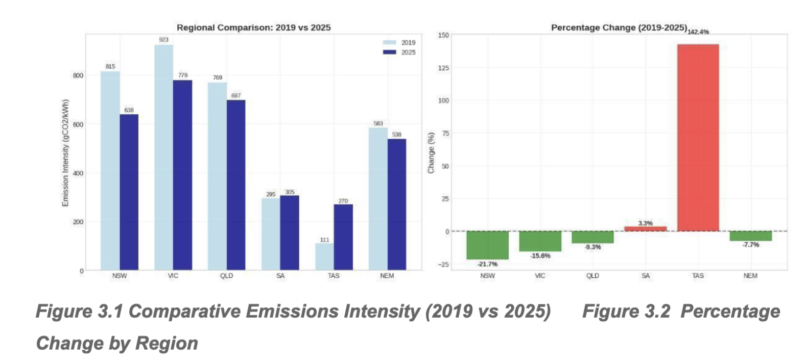
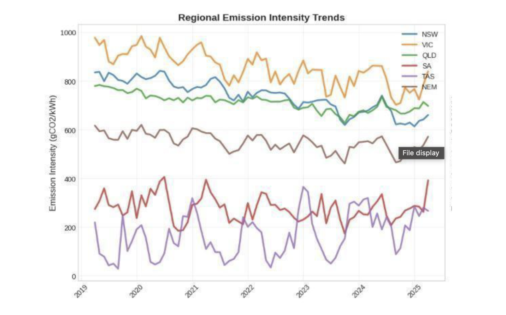
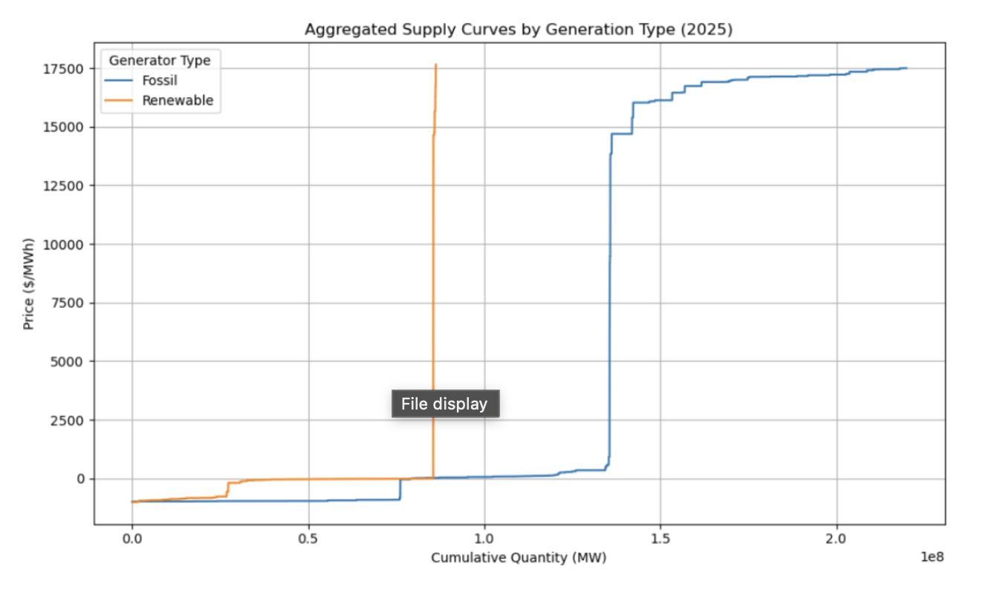
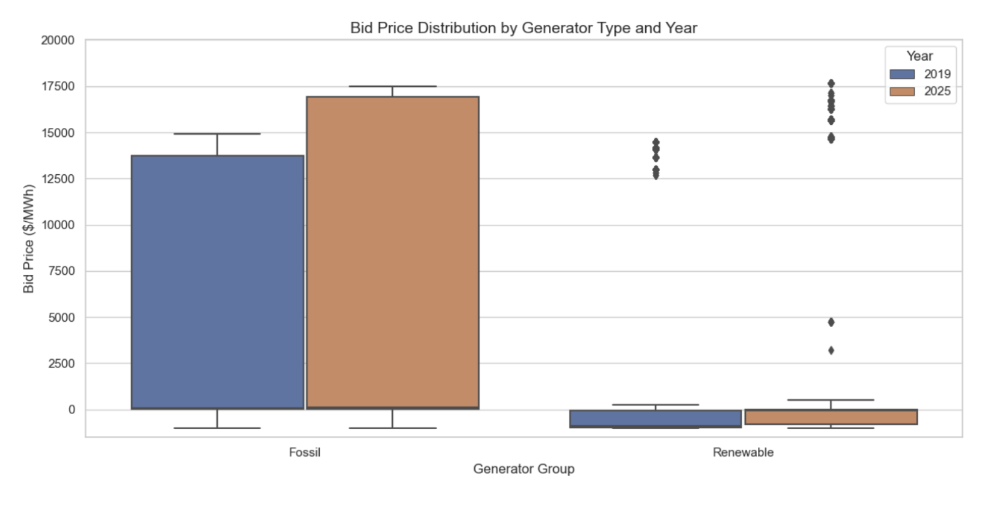
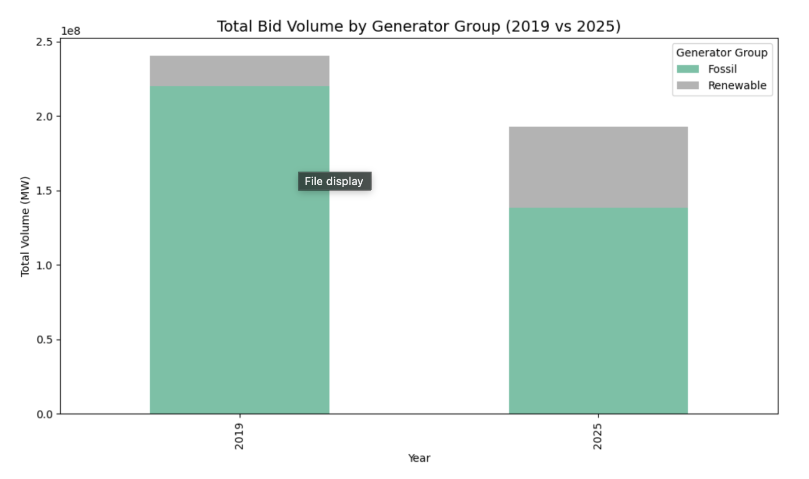

# NEM Emissions & Bidding Analysis

Analysis of Australian National Electricity Market (NEM) emissions intensity and generator bidding behaviour using Python, covering 5-minute interval dispatch and emissions data across NEM regions.

## Overview

This project analyses carbon emissions intensity and generator bidding behaviour in the Australian National Electricity Market (NEM) using Python.

Using emissions data from April 2019 to April 2025 and generator bid data for April 2019 and April 2025 (the 2025 bid file is about 1.6 million rows), the analysis examines how Australia's electricity market evolved between 2019 and 2025, focusing on regional decarbonisation trends, intra-day emissions patterns, and strategic bidding behaviour by fossil-fuel generators.

The project was completed as part of a Macquarie University capstone project and awarded a Distinction.

**Key Result:** NSW reduced carbon intensity by 21.7% between 2019 and 2025, while fossil fuel generator bidding became significantly more volatile, with the bid price interquartile range widening from $85/MWh in 2019 to $210/MWh in 2025.

## Analytical Questions

1. How did carbon intensity change across NEM regions between 2019 and 2025?
2. How did fossil fuel generator bid prices differ between 2019 and 2025?
3. What regional and intra-daily emissions patterns were visible in the data?

## Data & Methodology

### Data Sources

- CSIRO NEM Emissions API
- NEM generator bid-stack files for April 2019 and April 2025
- Five NEM regions: NSW, VIC, QLD, SA and TAS

### Dataset Size

- 2025 bid file of about 1.6 million rows (over 16 million after reshaping to long format)
- Emissions data at five-minute intervals, April 2019 to April 2025 (73 months), aggregated to monthly averages
- Generator bidding and emissions records analysed across regions and technologies

### Data Processing

- Extracted and cleaned dispatch and emissions datasets using Python and pandas
- Standardised timestamps and regional identifiers
- Aggregated 5-minute interval data to support regional and temporal comparisons
- Filtered and analysed fossil fuel generator bidding data across selected 2019 and 2025 periods
- Calculated carbon intensity metrics and bidding price distributions
- Produced comparative visualisations for emissions trends and market behaviour

### Key Decisions

- Emissions were analysed as a monthly series from April 2019 to April 2025, while bidding was compared using April 2019 and April 2025 only, rather than the full historical NEM dataset
- Fossil fuel generators were analysed separately to examine changes in bidding behaviour
- Carbon intensity comparisons were performed at both regional and national levels
- Interquartile range (IQR) was used to measure changes in bid price volatility

## Key Findings

**NSW recorded the largest emissions improvement**  
NSW reduced carbon intensity by 21.7% between 2019 and 2025, outperforming the national average decline of 7.7%.

**Fossil generator bidding was more volatile in April 2025 than in April 2019**  
Comparing April 2019 with April 2025, the fossil bid price interquartile range widened from $85/MWh in 2019 to $210/MWh in 2025. This is a two-point comparison, not a continuous trend. The report's supply curve comparison suggests increased strategic bidding and stronger peak-pricing behaviour, which is an interpretation of the curve shapes, not a measurement of why generators bid as they did.

**Regional emissions profiles differed substantially**  
Time-series and intra-day analysis revealed significant variation across NEM regions, demonstrating that aggregate national trends masked important regional differences.

## Tech Stack

- Python
- pandas
- Matplotlib
- CSIRO NEM Emissions API

## Skills Demonstrated

- Python data cleaning and preparation
- Time series analysis using 5-minute interval dispatch data
- Data aggregation and regional comparison
- Matplotlib visualisation and analytical reporting
- Translating technical findings into a client-style analytical report

## Project Structure

- cleandata.py - Data extraction, cleaning and preparation
- plot1.py to plot5.py - Individual visualisation scripts
- Report.pdf - Capstone report excerpt containing findings and recommendations

## Dashboard & Visualisation Preview

### 1. Regional Emissions Comparison

### 2. Combined Regional Trends

### 3. Supply Curve: Fossil vs Renewable

### 4. Bid Price Distribution (2019 vs 2025)

### 5. Total Bid Volume by Generator Type

## Contribution Note

This was a group capstone project completed at Macquarie University. I did the Python for the bidding analysis and the data cleaning. The Python code included in the linked repository is the cleaned, shareable version of the project code. The report PDF is an excerpt of the collaborative group report with the cover page removed. Full group authorship is acknowledged.

## Limitations

- The project compares April 2019 with April 2025 for bidding and uses a monthly April 2019 to April 2025 series for emissions, so findings should be interpreted within the scope of the available data.
- The bidding comparison uses one month in each year (April 2019 and April 2025), so it may not reflect other seasons.
- The wider spread of fossil bid prices is described, not explained. The link to strategic peak pricing is an interpretation.
- Generators are grouped by keyword on generation type, and any type that is not solar, wind or hydro is counted as fossil.
- The analysis is descriptive and does not claim causal attribution for market behaviour changes.