# Website Tracking and QA: Case Study

A tracking implementation and QA project on my portfolio site (vivekdhanwada.github.io). It covers a baseline audit, a measurement plan, an event specification, a build in Google Tag Manager and GA4, QA with a deliberate failure, and an audit of overlapping events. This is portfolio scale, not client work.

**Business Question:** How can a team tell that tracking still works after a site release, and catch it when it silently breaks?

**Key Finding:** Deliberately renaming one dataLayer key dropped a parameter from an event with no error message in the console, GTM or GA4, and the GTM tag still reported Succeeded. It was caught only by checking variable values in Tag Assistant and parameters in DebugView.

Live report: [Portfolio Tracking Report](https://datastudio.google.com/reporting/bccb2e6a-e81c-4219-b3cd-f641908a9696)

## Baseline audit

Taken on 19 October 2026, before any change, from the GA4 property over the last 28 days.

| Area | Finding |
|---|---|
| Events collected | 7, all automatic: page_view, session_start, first_visit, user_engagement, scroll, click, file_download |
| Custom events | None |
| Key events and audiences | None in use |

- Resume opens, project clicks and contact clicks could not be told apart.
- The automatic click event covers outbound links only and does not separate resume, project and contact links.
- Scroll fired once, at 90 percent, so partial reading was invisible.

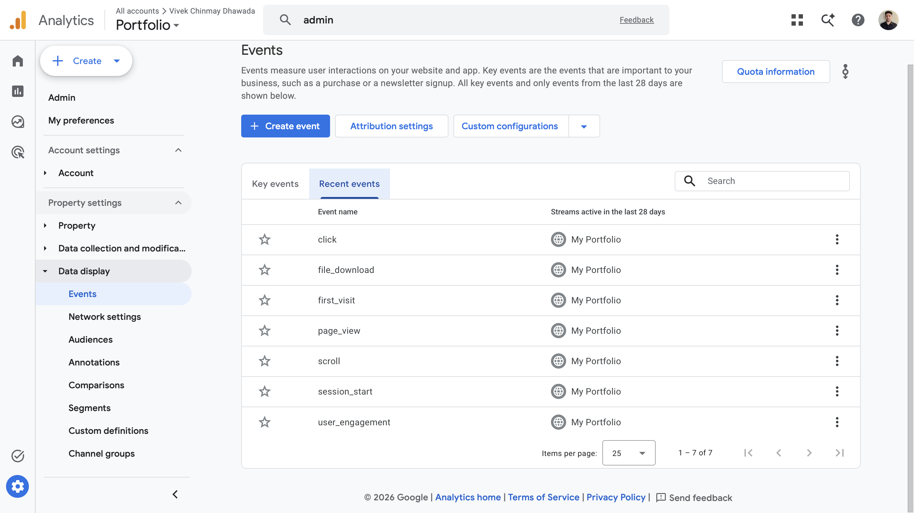

Recommendation: add five custom events from a written specification, mark `resume_download` and `contact_click` as key events, and switch off the three overlapping automatic events once the custom ones pass QA.

## Measurement plan

Version 1.0, 19 October 2026.

**Objective:** measure how many visitors to this portfolio view my work, open my resume and contact me, and which channels they come from. At this traffic the values are directional, so the plan shows the measurement design, not conclusions.

| KPI | Definition | Events and data | Decision it informs |
|---|---|---|---|
| Resume interest | Resume opens per 100 engaged sessions | `resume_download`, engaged sessions | Whether the resume button is placed and labelled well |
| Contact intent | Contact clicks by channel: email, LinkedIn, GitHub | `contact_click`, `contact_method` | Which channel to put first |
| Project engagement | Clicks to each project, and how far project pages are scrolled | `project_click`, `scroll_depth`, `outbound_click` | Which projects to feature, and in what order |
| Outreach attribution | Sessions and key events by source, medium and campaign, and the number of sessions in Unassigned | Session source, medium, campaign, channel group, key events | Which channel brings engaged visitors, and whether the UTM standard is followed |

**Tracking health:** each custom event has a 7-day count and a last-seen date, shown on page 2 of the report. It is an operating check, not a KPI. A count and last-seen date show when an event stops arriving, not when a parameter goes missing. That needs the post-release test below or a parameter-level query.

**UTM standard for outreach links.** Links I share to this site carry `utm_source` (where it is posted, lowercase), `utm_medium` (the channel type, lowercase) and `utm_campaign` (purpose and month, hyphenated, for example recruiter-outreach-2026-10). Links within the site are never tagged, and each tagged link is recorded in a list.

## Event specification

Events are pushed to `window.dataLayer` by `assets/js/tracking.js` and sent to GA4 by Google Tag Manager. Names are snake_case and one event fires per click. When a link could match two events, the order of precedence is `resume_download`, `project_click`, `contact_click`, `outbound_click`. Every push sets every parameter its tag reads.

| Event | Trigger | Parameters | Role |
|---|---|---|---|
| `resume_download` | Click on a link to `/resume.pdf` on this site | `file_name`, `link_location` | Key event |
| `project_click` | Click on a project card on the landing or projects page | `project_name`, `project_slug`, `link_location` | Engagement |
| `contact_click` | Click on a mailto link, the LinkedIn profile or the GitHub profile root | `contact_method` (email, linkedin, github), `link_location` | Key event |
| `outbound_click` | Click on any other link to a different hostname | `link_domain`, `link_url` (query string removed), `link_location` | Engagement |
| `scroll_depth` | Scroll passes 25, 50, 75 or 100 percent, once per threshold per page load | `depth_percent` | Engagement |

`link_location` is one of `landing_button`, `landing_card`, `projects_index`, `navbar`, `footer`, `page_body`. Example push:

    { event: 'contact_click', contact_method: 'linkedin', link_location: 'footer' }

**Definitions that matter**

- `resume_download` counts opens of `resume.pdf` in a new tab, not confirmed saves. A visitor may close the tab without saving.
- `contact_click` is deliberately narrow: only the email, LinkedIn profile and GitHub profile links. Repository links and every other external link are `outbound_click`, so the key event does not inflate from project browsing.
- `link_url` is not registered as a custom dimension. `link_domain` answers where visitors go, and a full URL has too many unique values to chart.
- The theme attribution link and the theme toggle are not tracked.

## Build

**GTM swap.** The theme sent GA4 data through a direct gtag script. I replaced it with Google Tag Manager so tags can be changed and tested without editing the site. The direct tag is switched off in `_config.yml`, the GTM snippet loads in production builds only, and the same measurement ID keeps the property's history.

**tracking.js.** One plain JavaScript file with a delegated click listener in the capture phase and a throttled scroll listener. It reads each link's hostname and path, applies the order of precedence, and pushes one event to the dataLayer. A debug flag (`localStorage.tracking_debug = '1'`) prints every push to the console, so the script was tested before any GTM tag existed.

**Agentic Coding.** I built `tracking.js` with GenAI (Claude) from my event specification. I ran the QA and the deliberate break and fix, and I can explain how each part of the script works. The Playwright tests in `automated-tests/` were also written with GenAI (Claude) from the same event specification; I ran them and worked through the first-run failures.

**GTM and GA4.** Eight Data Layer Variables with no default value, so a missing key shows as undefined instead of being hidden. Five Custom Event triggers and five GA4 event tags, named `DLV - name`, `CE - name` and `GA4 - event - name`. Seven event-scoped custom dimensions are registered in GA4, all except `link_url`.

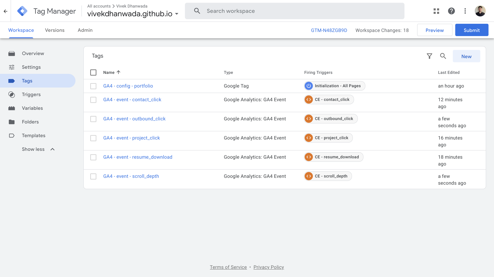

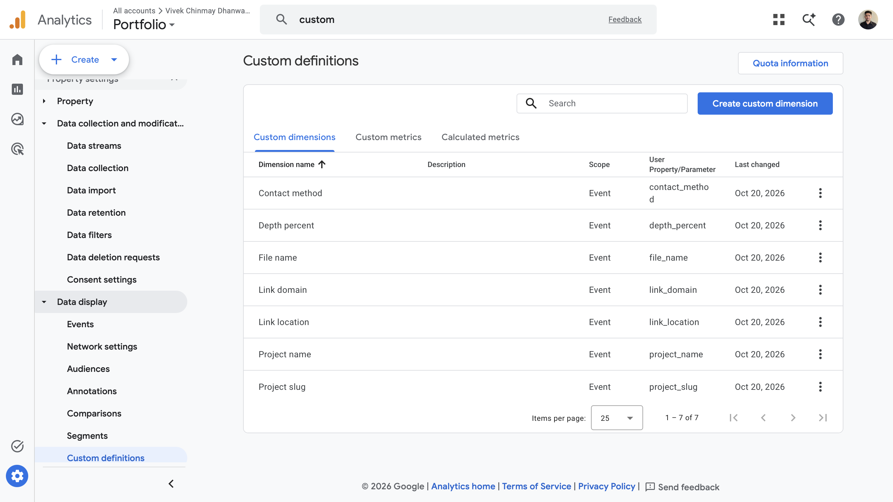

**Also set up.**
- Key events: `resume_download` and `contact_click`.
- Internal traffic: a Custom JavaScript variable (`JS - traffic_type`) sets a flag in my browser when a page loads with `?internal=1`, and the Google tag sends `traffic_type = internal`. GA4's default Internal Traffic filter matches it and is left in Testing. Clear the flag with `localStorage.removeItem("internal_traffic")`.
- Audience: Engaged visitors, users who triggered `project_click` in the last 30 days. It includes my own test clicks while the internal traffic filter is in Testing.
- BigQuery: a daily export of GA4 events to a dedicated Google Cloud project in sandbox mode, with tables that expire after 60 days. I ran the check below on the first table (20 Oct 2026). It counts `contact_click` events with no `link_location`, and returned 13 `contact_click` events, 1 of them missing the parameter, which matches the one click made while the key was renamed. Run daily, the same query catches this failure at parameter level:

      SELECT event_date,
        COUNTIF((SELECT value.string_value FROM UNNEST(event_params)
                 WHERE key = 'link_location') IS NULL) AS missing_link_location
      FROM `<project>.analytics_<property_id>.events_*`
      WHERE event_name = 'contact_click'
      GROUP BY event_date

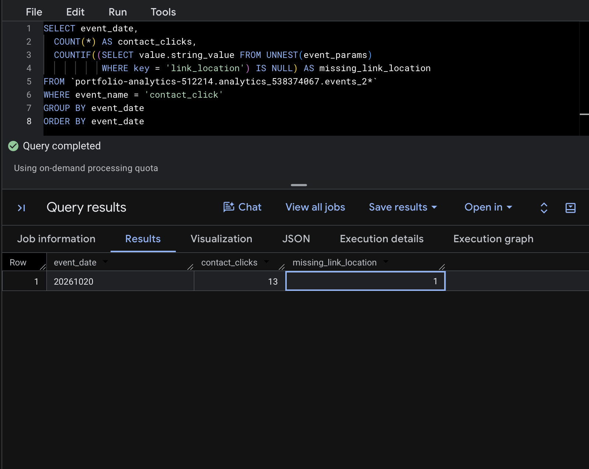

| Date | Change |
|---|---|
| 19 Oct 2026 | GTM swap. Container version 2: Google tag only |
| 19 Oct 2026 | `tracking.js` v1 live. Container version 3: 8 variables, 5 triggers, 5 event tags |
| 20 Oct 2026 | 7 custom dimensions registered in GA4 |
| 20 Oct 2026 | `tracking.js` v2 (deliberate break), then v3 (fix) |
| 20 Oct 2026 | Three overlapping automatic events switched off |
| 20 Oct 2026 | Internal traffic flag. Container version 4 |
| 20 Oct 2026 | Key events marked, Engaged visitors audience created, BigQuery export switched on |
| 21 Oct 2026 | Playwright tests added: 18 tests across Chromium and WebKit |

## QA log

Tested on the live site with Tag Assistant, GA4 DebugView and the browser developer tools console, on desktop, mainly in Safari, with some events also checked in Chrome. Phone not tested.

| Event | Test | Expected | Result |
|---|---|---|---|
| `page_view` | Home page load after the GTM swap | One event per load | Pass |
| `resume_download` | Resume button on the landing page | `file_name` resume.pdf, `link_location` landing_button | Pass |
| `project_click` | Landing card and projects page card | `project_name`, `project_slug`, `link_location` landing_card or projects_index | Pass |
| `contact_click` | LinkedIn button, email, GitHub and LinkedIn in footer and navbar | `contact_method`, `link_location` landing_button, footer or navbar | Pass |
| `outbound_click` | Source code link on a project page | `link_domain` github.com, `link_location` page_body, no second `contact_click` | Pass |
| `scroll_depth` | Scroll to the bottom of three pages | 25, 50, 75 and 100 once each per page | Pass |
| Same-tab links | Footer icons, which leave in the same tab | Push logged before the page unloads | Pass. GA4 receipt confirmed in DebugView |

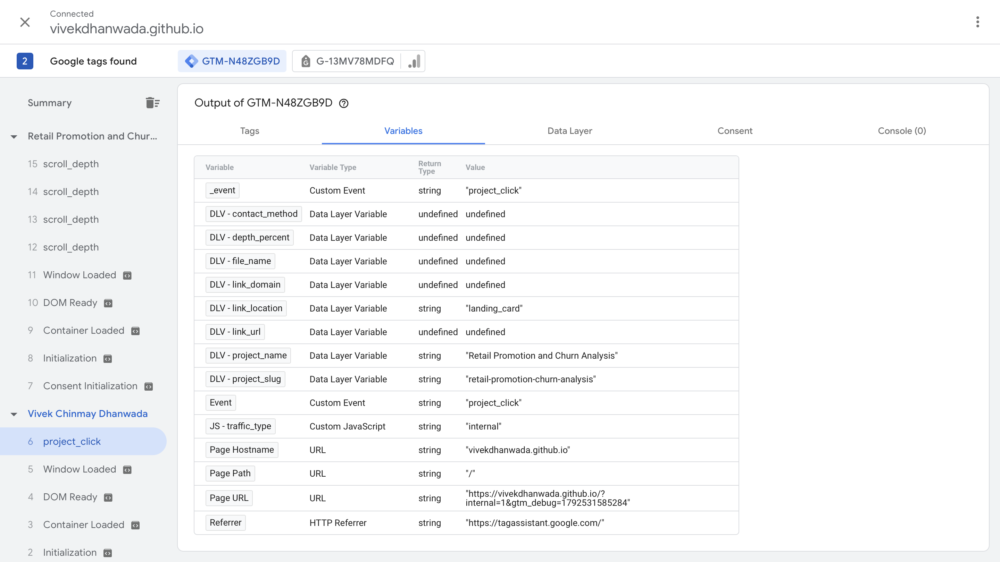

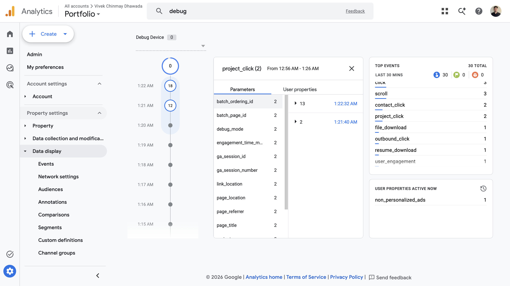

### Deliberate break and fix

On 20 October 2026 I renamed the dataLayer key `link_location` to `link_loc` for `contact_click` in `tracking.js` (v2) and pushed it.

- **What happened:** the event still fired and GA4 received it, but without `link_location`. No error message appeared in the console, GTM or GA4, and the GTM tag reported Succeeded.
- **How it was found:** in Tag Assistant, `DLV - link_location` read undefined while `DLV - contact_method` read linkedin. In DebugView, the parameter was missing from the event.

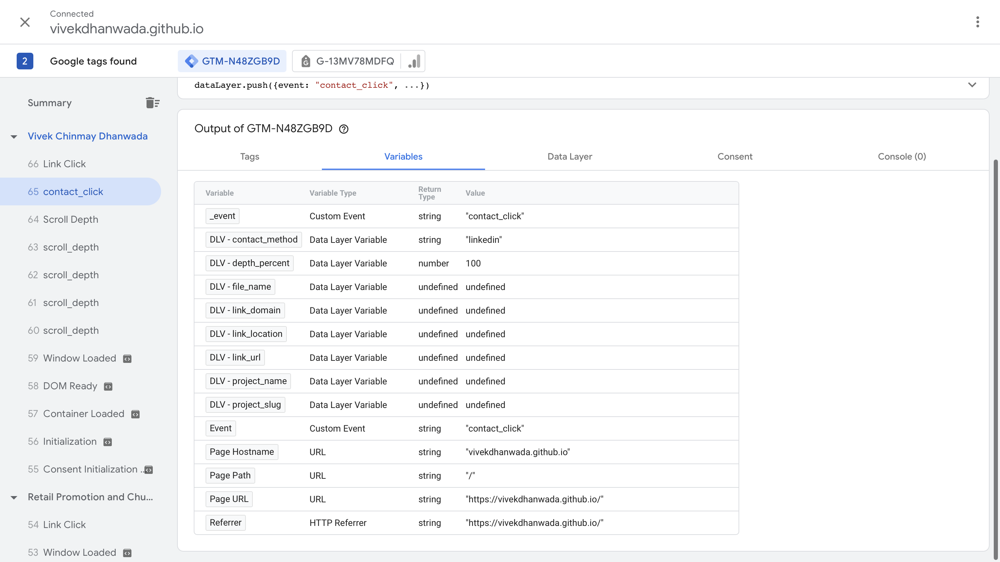

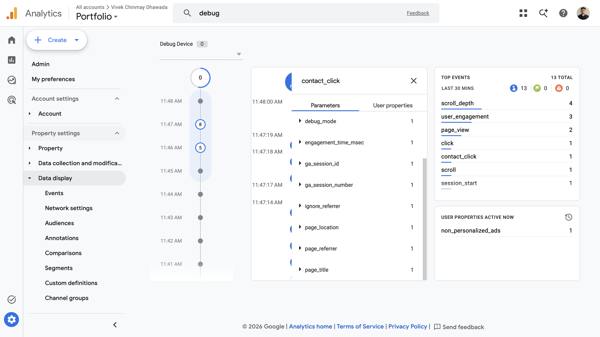

- **Fix:** restored the key (v3). Tag Assistant then showed `link_location` as landing_button, and DebugView listed the parameter again.

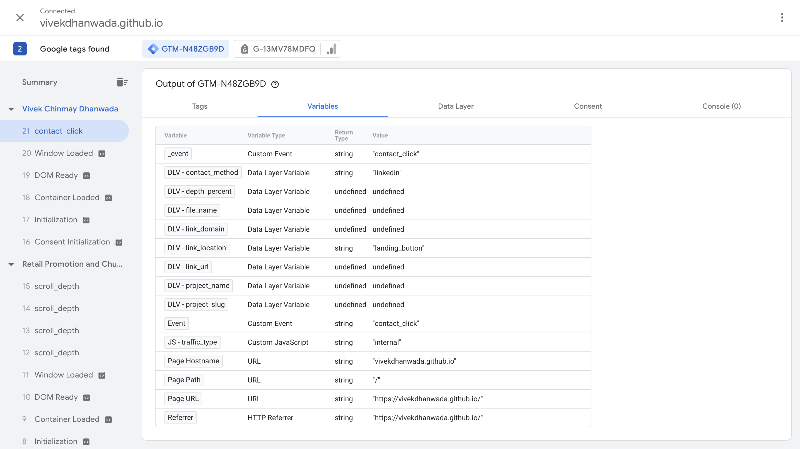

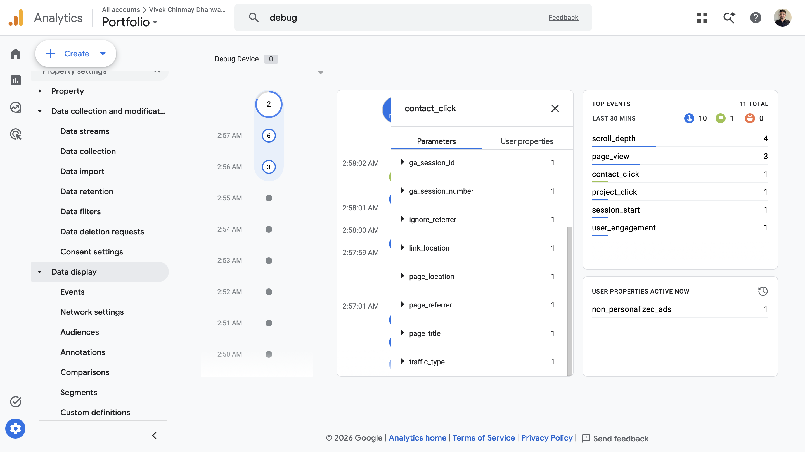

A Succeeded status on a tag does not prove every parameter was sent. Checking variable values and DebugView parameters is the test that catches this.

### Automated tests

On 21 October 2026 I added Playwright tests (`automated-tests/`) that repeat the post-release test in code. Each test loads the live site, clicks a link, and checks the dataLayer push against the event specification, then checks that the outgoing GA4 request carries the same values. The request is answered locally, so no test data is recorded. All 18 tests passed (9 in each of Chromium and WebKit, the engine Safari uses). To run them, use `npx playwright test` from the `automated-tests/` folder. The first run had 4 failures that came from a wrong URL in my tests, not from the tracking: this site publishes pages without a trailing slash. Run against a copy of `tracking.js` with `link_location` renamed to `link_loc` (the deliberate break), 14 of the 18 tests fail with "link_location is missing from the push". The other 4 do not involve that parameter.

## Audit of overlapping events

GA4 Enhanced Measurement was sending click, file_download and scroll alongside the custom `outbound_click`, `resume_download` and `scroll_depth`, so the same interactions were measured twice under different event names. After the custom events passed QA, I switched off Outbound clicks, File downloads and Scrolls.

| Event | Before | After |
|---|---|---|
| `click`, `file_download`, `scroll` (automatic) | Present | Absent |
| `outbound_click`, `resume_download`, `scroll_depth` (custom) | Present | Present |

Compared by presence in DebugView for the same interactions, so the counts themselves are not compared.

## Recommendations

1. **Test after every release.** Post-release test:
   1. Open the live site with GTM Preview connected and the debug flag on.
   2. Click one of each: Resume, a project card, each contact channel, an outbound link. Scroll a project page to the bottom.
   3. In Tag Assistant, confirm each event appears, its tag fired, and no variable reads undefined. Also compare the dataLayer push for that event in the Data Layer tab, because a variable can keep a value from an earlier push.
   4. In DebugView, confirm each event arrives with every parameter in the specification.
   5. Log the date, the `tracking.js` and container versions, and pass or fail. Fix and retest any failure.

   The `automated-tests/` folder runs these checks on every event in under a minute.
2. **Audit overlapping events before adding new ones.** Check what Enhanced Measurement already collects, and switch off the overlap once the replacement is tested.
3. **Document every event and KPI before building reports on them.** A name like `resume_download` implies a saved file, but it counts opens. A written specification of each event's trigger, parameters and role, plus a definition for each KPI, keeps reports from being misread.

## Report

A two-page Looker Studio report (Google now calls it Data Studio), counting from 19 October 2026.
- Page 1, Visitor behaviour: sessions, engaged sessions, resume opens, contact clicks and project clicks (the resume rate is read from resume opens and engaged sessions), with contact clicks by channel, project clicks by project and scroll depth by page.
- Page 2, Traffic and tracking health: sessions and key events by source, medium, campaign and channel (including Unassigned), the 7-day count and last-seen date of each custom event, top pages, and link clicks by location.

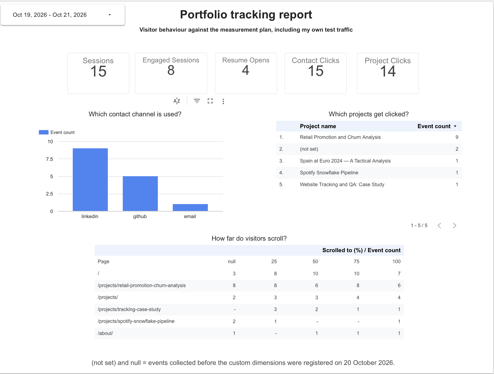

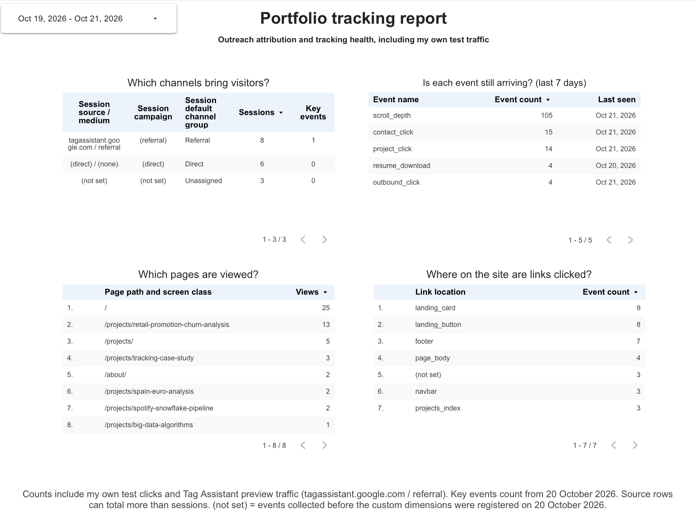

## Limits

- Portfolio scale: traffic is low, counts are small, and my own test clicks are in the data from 19 October 2026. A zero-event day is not a reliable alert at this volume. Tag Assistant preview sessions also appear as a `tagassistant.google.com` referral in the attribution table.
- Tested on desktop only, mainly in Safari.
- Middle-click and context-menu opens in a new tab are not captured. A page that fits one viewport pushes no `scroll_depth`.
- Consent is not implemented: GA4 sets first-party `_ga` cookies, and there is no banner or Consent Mode. I have not assessed legal requirements for any audience.
- The GTM noscript fallback is not installed, so visitors with JavaScript disabled are not tracked.
- The BigQuery export runs in sandbox mode, so tables expire after 60 days.
- The automated tests check that events fire and reach GA4 with the right values, not how GA4 reports them. They depend on the site's current link structure and need updating if it changes.

## Files

- `README.md`: this document.
- `tracking.js`: the dataLayer script, version 3.
- `gtm-container-v4.json`: the GTM container export, version 4.
- `screenshots/`: the 12 images used above.
- `automated-tests/`: Playwright tests that check each event against the specification in Chromium and WebKit (the engine Safari uses)